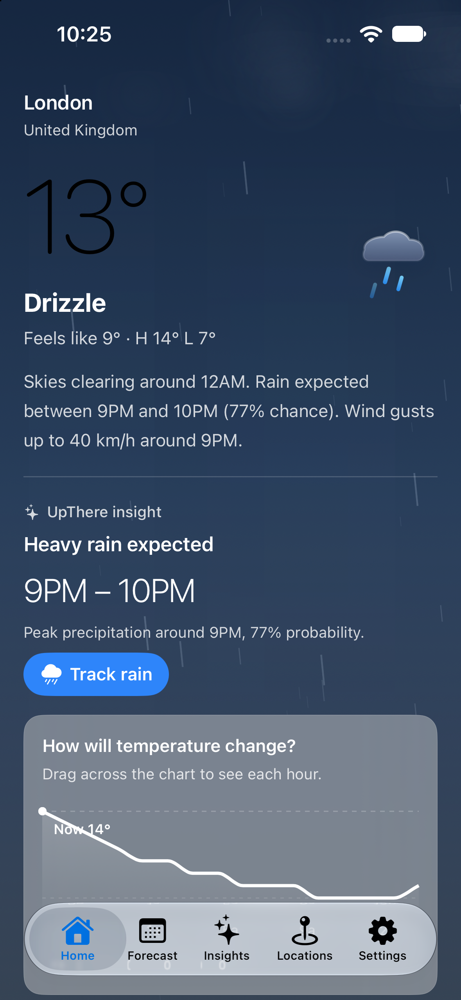
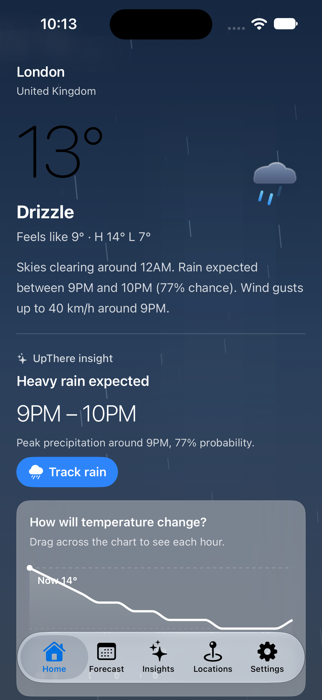
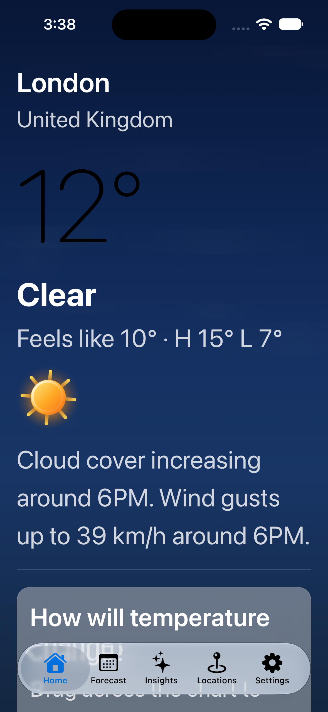
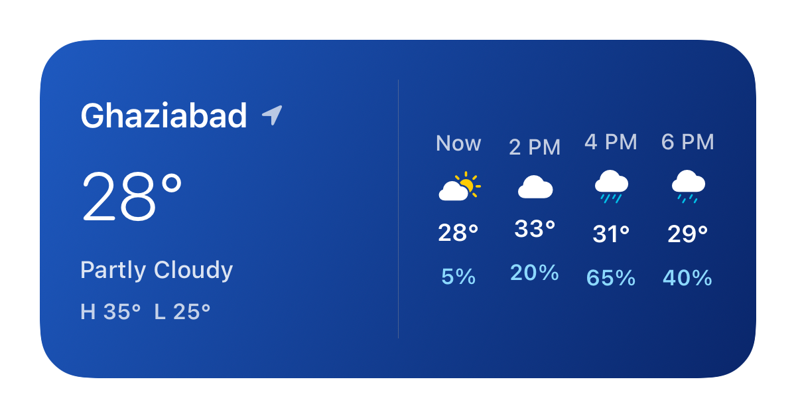
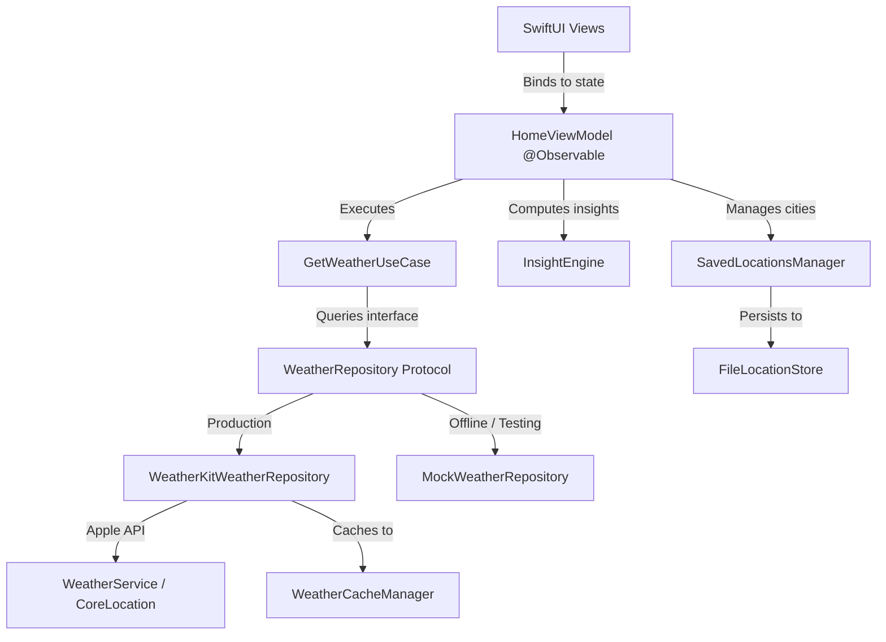

# UpThere

[](https://swift.org)
[](https://developer.apple.com/ios/)
[](https://developer.apple.com/xcode/swiftui/)

An iOS weather application built with SwiftUI, Apple WeatherKit, and deterministic forecast intelligence algorithms.

<p align="center">
  
</p>

### Interface & Adaptability

| Light Mode | Dark Mode | Dynamic Type | WidgetKit |
| :---: | :---: | :---: | :---: |
|  |  |  |  |

---

## Overview

Most weather applications present raw meteorological metrics—barometric pressures, percentages, and millibar measurements—leaving the user to interpret what those numbers mean for their daily schedule. UpThere bridges this gap by transforming hourly forecast telemetry into clear, actionable context: identifying exact precipitation windows, assessing outdoor activity suitability, tracking temperature swings, and flagging peak UV periods. Designed natively for iOS 26, the app pairs this analytical engine with dynamic atmospheric sky rendering, custom vector illustrations, and platform integrations across widgets, Control Center, Siri Shortcuts, and Spotlight.

---

## Architecture

The project follows a clean, modular architecture separating Presentation, Domain business logic, Data repositories, and Platform integration.



### Verified Test Coverage by Layer

All **84 tests** across **5 test suites** pass deterministically using Apple's Swift Testing framework (`@Suite`, `@Test`, `#expect`):

| Layer | Test Count | Key Areas Covered |
| :--- | :---: | :--- |
| **Presentation Layer** *(Views & ViewModels)* | **25** | `HomeViewModel` debouncing, tab-switch cache hits, refresh failure banners, error retryability states, `SettingsViewModel` bundle versioning and AppGroup bindings, `CitySearchViewModel` typing debounce and cancellation, `WeatherFormatter` observable unit dynamic updates without view recreation. |
| **Domain Layer** *(Business Logic & Models)* | **27** | `InsightEngine` weather patterns (UV peaks, polar days, storm nights, rain windows), `RainActivityStateCalculator` Live Activity state machine, domain entity conversions, severe alert expiration logic. |
| **Data Layer** *(Services, Repositories & Storage)* | **20** | `LocationService` (timeout within 4s, reverse-geocoding immutability, request generation counter), `SavedLocationsManager` & `FileLocationStore` (persistence, restarts, 5 km duplicate detection, current location protection, migration), `WeatherCacheManager`, `NotificationScheduler` alert deduplication. |
| **Platform & Integration Layer** *(Intents, Widgets, Spotlight, App Group)* | **12** | `WidgetSnapshot` & `WidgetSnapshotStore` round-trip, `WeatherWidgetEntry` fresh/stale/empty timeline entries, `CheckWeatherIntent`, `TrackRainIntent`, `ToggleSevereAlertsIntent`, `LocationEntityQuery`, `SpotlightService`, `AppGroup` migration. |
| **Total** | **84** | **100% Passing** |

---

## Key Features

### 1. Weather Experience
- **Atmospheric Sky Engine**: Multi-layer background canvas reflecting real-time weather conditions, ambient lighting, and diurnal shifts with restrained particle motion for rain, snow, fog, and storms.
- **Animated Vector Illustrations**: Custom SwiftUI path-based vector illustrations (`WeatherIllustrationView`) providing fluid visual feedback without static raster assets.
- **Interactive Temperature Scrubbing**: Canvas-rendered hourly temperature curve (`TemperatureLineChart`) with monotonic cubic smoothing and touch scrubbing to inspect discrete hourly data points.
- **Liquid Glass & Materials**: Cohesive visual hierarchy utilizing SwiftUI's native `.glassEffect` styling on navigation bars, controls, and tab bars alongside system materials on content cards.

### 2. Forecast Intelligence (`InsightEngine`)
- **Precipitation Windows**: Identifies rain onset, cessation, peak probability hour, and accumulated volume from hourly data slices.
- **Outdoor Suitability Scoring**: Multi-factor heuristic evaluating temperature comfort bands (18–25°C), precipitation penalties, wind velocity, and UV exposure to score the best time for outdoor activities.
- **Diurnal Temperature Trends**: Identifies daily highs, lows, and rapid swings between sequential hours.
- **Extended Forecasts**: 24-hour continuous timeline and 10-day outlook with high/low range bars and precipitation probabilities.

### 3. Location and Personalization
- **City Search**: Fast, debounced city search powered by Apple MapKit (`MKLocalSearch`) utilizing iOS 26 location and address representations.
- **Multi-City Management**: Saved locations list with reordering, swipe deletion, and automatic pinning of the device's current location.
- **Proximity Deduplication**: Enforces a 5 km minimum threshold (`CLLocation.distance`) to prevent duplicate city entries within the same metropolitan area.
- **Observable Unit Preferences**: Reactive `@Observable` unit settings (`UnitPreferences`) for temperature (°C / °F), wind speed (km/h / mph / m/s / kn), and precipitation (mm / in) injected through the SwiftUI Environment.
- **Graceful Fallbacks**: Deterministic fallback to coordinate presets (Ghaziabad) when location permissions are denied or unavailable.

### 4. Native iOS Integrations
- **WidgetKit**: Home Screen and Lock Screen widgets supporting `.systemSmall`, `.systemMedium`, `.systemLarge`, `.accessoryCircular`, `.accessoryRectangular`, and `.accessoryInline` families.
- **Control Center**: Quick weather launcher control and severe weather alert toggle control (`ControlWidget`).
- **App Shortcuts & Siri**: Siri shortcuts (`UpthereShortcuts`) for checking current weather (`CheckWeatherIntent`), opening locations (`OpenLocationIntent`), toggling severe alerts (`ToggleSevereAlertsIntent`), and tracking rain (`TrackRainIntent`).
- **CoreSpotlight Indexing**: Automatic indexing of current weather conditions and saved cities into iOS system search via `CSSearchableItem`.

---

## Technical Highlights

### Deterministic Insight Engine (`InsightEngine`)
Rather than relying on server-side processing or machine learning models, forecast insights are computed entirely on-device using pure Swift algorithms. The `InsightEngine` inspects `[HourlyWeather]` slices across six deterministic functions:
- `rainWindow`: Scans hourly probabilities to compute start, peak, and end timestamps along with total precipitation volume.
- `bestOutdoorWindow`: Implements a scoring function penalizing rain probability (up to -80 pts), deviation from optimal comfort temperatures (18–25°C), high winds (>20 km/h), and extreme UV (>7) across sliding 3-hour windows.
- `temperatureTrend`: Calculates daily swings and inflection point timestamps.
- `strongestWind`: Evaluates sustained speeds against peak gust windows.
- `peakUV`: Pinpoints midday solar intensity boundaries.
- `cloudChange`: Measures delta rates across cloud coverage arrays to detect incoming fronts or clearing skies.

### Repository Abstraction & Testing Architecture
Data access is isolated behind the `WeatherRepository` protocol:
- **`WeatherKitWeatherRepository`**: Wraps Apple's `WeatherService`, handles geocoding coordinate resolution, maps system errors into strongly-typed `WeatherServiceError` cases, and caches responses.
- **`MockWeatherRepository`**: Provides fully deterministic mock fixtures and simulated network latency for testing and simulator development without active Apple Developer certificates.

### State Management & Concurrency
- **Observation Framework**: ViewModels utilize Swift's `@Observable` macro for property-level view invalidation and reduced view re-renders compared to `ObservableObject`.
- **Actor Isolation**: All UI-facing view models and container factories are isolated to `@MainActor`.
- **AsyncStream Location Updates**: `LocationService` bridges CoreLocation delegate callbacks into an asynchronous sequence (`AsyncStream<CLLocation>`), allowing view models to reactively consume location changes without tight delegate coupling.
- **Request Cancellation**: In-flight fetch tasks are managed via structured `Task` references, automatically cancelling superseded requests on city change or rapid refresh.

### Cache Strategy & Storage
- **`WeatherCacheManager`**: Stores timestamped JSON payloads in `UserDefaults` using sanitized city and coordinate keys. Cache records maintain freshness for 30 minutes and allow stale reads up to 24 hours to support offline launches.
- **`FileLocationStore`**: Stores saved location metadata as JSON directly in `Application Support/Upthere/`, ensuring persistence independent of cache flushes, with an automated migration routine for legacy `UserDefaults` stores.

---

## Quick Start

### Prerequisites
- macOS 15.0+
- Xcode 26.0+
- iOS 26.0+ Simulator or physical device

### Building the Project

1. **Clone the repository:**
   ```bash
   git clone https://github.com/Vedanshi-Prajapati/Upthere.git
   cd Upthere
   ```

2. **Open the project in Xcode:**
   ```bash
   open Upthere.xcodeproj
   ```

3. **Select Scheme and Destination:**
   - Select the `Upthere` scheme.
   - Choose an iOS 26.0+ Simulator (such as `iPhone 16`).

4. **Run:**
   - Press `Cmd + R` to build and launch.

### Live Data vs. Mock Development
- **Live WeatherKit Data**: Apple WeatherKit requires an active Apple Developer Program account, an explicit App ID with the WeatherKit capability enabled, and proper code signing. The entitlement is defined in `Upthere/Upthere.entitlements`.
- **Offline / Simulator Testing**: To run the project without an active Apple Developer team or certificate, inject `MockWeatherRepository` into `AppContainer` (`Upthere/App/AppContainer.swift`), which provides full synthetic hourly and 10-day forecasts without external network calls.

### Running Tests via Terminal

```bash
xcodebuild test \
  -scheme Upthere \
  -destination "platform=iOS Simulator,name=iPhone 16" \
  -only-testing:UpthereTests
```

---

## Limitations

- **Notification Scheduling**: Weather notifications (rain onset alerts and severe weather alerts) are scheduled and rescheduled only during active app refresh cycles (e.g. user pull-to-refresh or foreground launch). The app does not currently implement background app refresh (`BGAppRefreshTask`) to periodically query WeatherKit while suspended.
- **WeatherKit Entitlement Requirement**: Fetching real-time meteorological data requires a paid Apple Developer account and signed bundle provisioning with the `com.apple.developer.weatherkit` entitlement.
- **Forecast Horizon**: The application displays up to 24 hourly intervals and a 10-day daily forecast based on the maximum forecast windows provided by Apple's WeatherService.
- **Geocoding Availability**: City name resolution, MapKit city searches, and reverse geocoding rely on Apple network services (`MKLocalSearch` and `CLGeocoder`).
