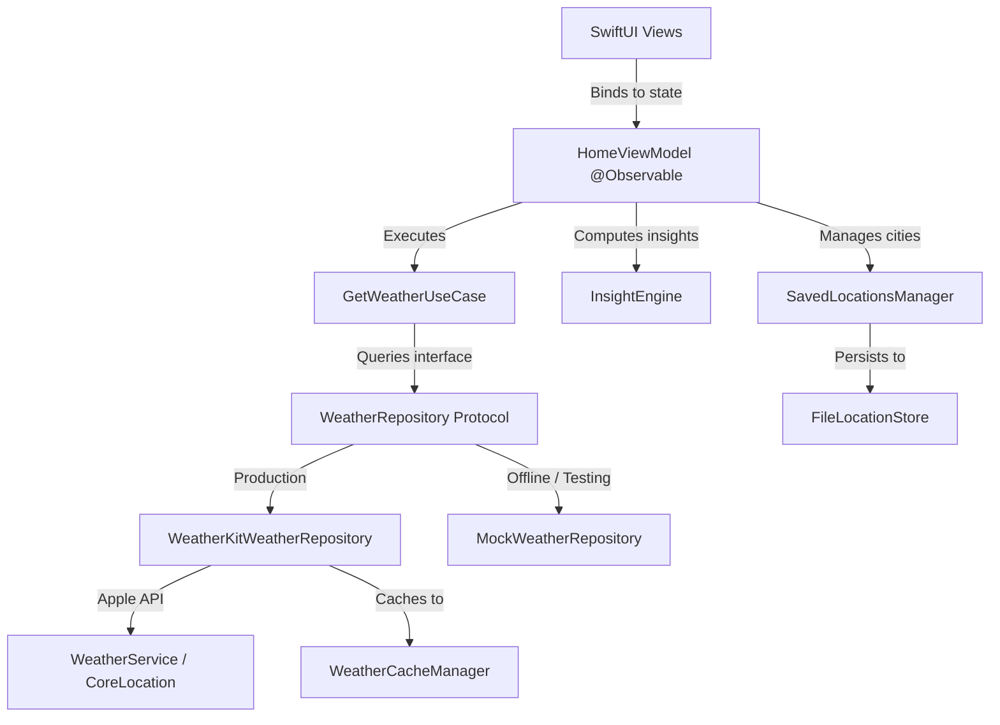

# UpThere

[](https://swift.org)
[](https://developer.apple.com/ios/)
[](https://developer.apple.com/xcode/swiftui/)

An iOS weather application built with SwiftUI, Apple WeatherKit, and deterministic forecast intelligence algorithms.

---

## Overview

Most weather applications present raw meteorological metrics—barometric pressures, percentages, and millibar measurements—leaving the user to interpret what those numbers mean for their daily schedule. UpThere bridges this gap by transforming hourly forecast telemetry into clear, actionable context: identifying exact precipitation windows, assessing outdoor activity suitability, tracking temperature swings, and flagging peak UV periods. Designed natively for iOS, the app pairs this analytical engine with dynamic atmospheric sky rendering, custom vector animations, and platform integrations across widgets, Control Center, Siri, and Spotlight.

---

## Key Features

### 1. Weather Experience
- **Atmospheric Sky Engine**: Multi-layer background canvas reflecting real-time weather conditions, ambient lighting, and diurnal shifts with restrained particle motion for rain, snow, fog, and storms.
- **Animated Vector Illustrations**: Custom SwiftUI path-based vector illustrations (`WeatherIllustrationView`) providing fluid visual feedback without static raster assets.
- **Interactive Temperature Scrubbing**: Canvas-rendered hourly temperature curve (`TemperatureLineChart`) supporting touch scrubbing to inspect discrete hourly data points.
- **Glassmorphic Material Design**: Cohesive visual hierarchy using native system materials, translucent vibrancy, and dynamic typography.

### 2. Forecast Intelligence
- **Precipitation Windows**: Identifies rain onset, cessation, peak probability hour, and accumulated volume from hourly data slices.
- **Outdoor Suitability Scoring**: Multi-factor heuristic evaluating temperature comfort bands (18–25°C), precipitation penalties, wind velocity, and UV exposure to score the best time for outdoor activities.
- **Diurnal Temperature Trends**: Identifies daily highs, lows, and rapid swings between sequential hours.
- **Extended Forecasts**: 24-hour continuous timeline and 10-day outlook with high/low range bars and precipitation probabilities.

### 3. Location and Personalization
- **Multi-City Management**: Saved locations list with reordering, swipe deletion, and automatic pinning of the device's current location.
- **Proximity Deduplication**: Enforces a 5 km minimum threshold (`CLLocation.distance`) to prevent duplicate city entries within the same metropolitan area.
- **Unit Preferences**: Configurable temperature (°C / °F), wind speed (km/h / mph / m/s / kn), and precipitation (mm / in) units.
- **Graceful Fallbacks**: Deterministic fallback to coordinate presets (Ghaziabad) when location services are disabled, denied, or unavailable.

### 4. Native iOS Integration
- **WidgetKit**: Home Screen and Lock Screen widgets supporting `.systemSmall`, `.systemMedium`, `.systemLarge`, `.accessoryCircular`, `.accessoryRectangular`, and `.accessoryInline` families.
- **Control Center (iOS 18+)**: Quick weather launcher control and severe weather alert toggle widget (`ControlWidget`).
- **App Intents & Siri Shortcuts**: Native Siri shortcuts (`UpthereShortcuts`) for checking current conditions, switching cities, and updating notification settings.
- **CoreSpotlight Indexing**: Automatic indexing of current weather conditions and saved cities into iOS system search via `CSSearchableItem`.

---

## Technical Highlights

### Deterministic Insight Engine (`InsightEngine`)
Rather than relying on server-side processing or machine learning models, forecast insights are computed entirely on-device using pure Swift algorithms. The `InsightEngine` inspects `[HourlyWeather]` slices across six deterministic functions:
- `rainWindow`: Scans hourly probabilities to compute start, peak, and end timestamps along with total precipitation volume.
- `bestOutdoorWindow`: Implements a scoring function penalizing rain probability (up to -80 pts), deviation from optimal comfort temperatures (18–25°C), high winds (>20 km/h), and extreme UV (>7) across sliding 3-hour windows.
- `temperatureTrend`: Calculates daily swings and inflection point timestamps.
- `strongestWind`: Evaluates sustained speeds against peak gust windows.
- `peakUV`: Pinpoints midday solar intensity boundaries.
- `cloudChange`: Measures delta rates across cloud coverage arrays to detect incoming fronts or clearing skies.

### Repository Abstraction & Testing Architecture
Data access is isolated behind the `WeatherRepository` protocol:
- **`WeatherKitWeatherRepository`**: Wraps Apple's `WeatherService`, handles geocoding coordinate resolution, maps system errors into strongly-typed `WeatherServiceError` cases, and caches responses.
- **`MockWeatherRepository`**: Provides fully deterministic mock fixtures and simulated network latency for testing and simulator development without active Apple Developer certificates.

### State Management & Concurrency
- **Observation Framework**: ViewModels utilize Swift's `@Observable` macro for property-level view invalidation and reduced view re-renders compared to `ObservableObject`.
- **Actor Isolation**: All UI-facing view models and container factories are pinned to `@MainActor`.
- **AsyncStream Location Updates**: `LocationService` bridges CoreLocation delegate callbacks into an asynchronous sequence (`AsyncStream<CLLocation>`), allowing view models to reactively consume location changes without tight delegate coupling.
- **Request Cancellation**: In-flight fetch tasks are managed via structured `Task` references, automatically cancelling superseded requests on city change or rapid refresh.

### Cache Strategy & Storage
- **`WeatherCacheManager`**: Stores timestamped JSON payloads in `UserDefaults` using sanitized city and coordinate keys. Cache records maintain freshness for 30 minutes and allow stale reads up to 24 hours to support offline launches.
- **`FileLocationStore`**: Stores saved location metadata as JSON directly in `Application Support/Upthere/`, ensuring persistence independent of cache flushes, and includes an automated migration routine for legacy `UserDefaults` stores.

---

## Architecture and Project Structure

The project follows a clean layered separation between UI Presentation, Domain business logic, Data repositories, and Platform integration.



### Directory Structure

```
Upthere/
├── App/
│   ├── AppContainer.swift              # MainActor dependency injection container
│   ├── AppTheme.swift                  # Color tokens, materials, and card styles
│   └── WeatherFormatter.swift          # Unit formatting and measurement conversion
├── Domain/
│   ├── Models/                         # Weather, HourlyWeather, DailyWeather entities
│   ├── Repositories/
│   │   └── WeatherRepository.swift     # Repository protocol definition
│   ├── UseCases/
│   │   └── GetWeatherUseCase.swift     # Weather retrieval business logic
│   └── InsightEngine.swift             # Deterministic weather-insight algorithms
├── Data/
│   ├── Repositories/
│   │   ├── WeatherKitWeatherRepository.swift # Live WeatherKit implementation
│   │   └── MockWeatherRepository.swift       # Deterministic mock implementation
│   └── Services/
│       ├── LocationService.swift       # CoreLocation wrapper with AsyncStream
│       ├── LocationStore.swift         # File-based JSON persistence in Application Support
│       ├── SavedLocationsManager.swift # 5km duplicate detection and city ordering
│       └── WeatherCacheManager.swift   # Cache policy (30m fresh, 24h stale fallback)
├── Features/
│   ├── Home/                           # Main view, ViewModel, and temperature line chart
│   ├── Forecast/                       # 10-day extended outlook
│   ├── Insights/                       # InsightEngine metric cards and charts
│   ├── Locations/                      # City search sheet and saved locations list
│   ├── Settings/                       # Native form for units, theme, and permissions
│   └── Shared/                         # Sky canvas, illustrations, and loading skeletons
├── Platform/
│   ├── Intents/                        # App Shortcuts and Siri intent definitions
│   └── Spotlight/                      # CoreSpotlight CSSearchableIndex service
├── UpthereWidgets/                     # WidgetKit timelines and Control Center controls
└── UpthereTests/                       # Swift Testing suite (@Suite, @Test)
```

---

## Quick Start

### Prerequisites
- macOS 14.5+ or macOS 15.0+
- Xcode 16.0+
- iOS 18.0+ Simulator or physical device

### Building the Project

1. **Clone the repository:**
   ```bash
   git clone https://github.com/Vedanshi-Prajapati/Upthere.git
   cd Upthere
   ```

2. **Open the project in Xcode:**
   ```bash
   open Upthere.xcodeproj
   ```

3. **Select Scheme and Destination:**
   - Select the `Upthere` scheme.
   - Choose an iOS 18.0+ Simulator (such as `iPhone 16 Pro`).

4. **Run:**
   - Press `Cmd + R` to build and launch.

### Live Data vs. Mock Development
- **Live WeatherKit Data**: Apple WeatherKit requires an active Apple Developer Program account, an explicit App ID with the WeatherKit capability enabled, and proper code signing. The entitlement is defined in `Upthere/Upthere.entitlements`.
- **Offline / Simulator Testing**: To run the project without an active Apple Developer team or certificate, inject `MockWeatherRepository` into `AppContainer` (`Upthere/App/AppContainer.swift`), which provides full synthetic hourly and 10-day forecasts without external network calls.

---

## Testing

The project uses Apple's **Swift Testing** framework (`@Suite`, `@Test`, `#expect`) to validate domain logic, state lifecycles, and edge cases.

### Verified Test Suites
- **`InsightEngineTests`**: Tests all six insight algorithms across synthetic meteorological fixtures (Clear Day, Rainy Afternoon, Stormy Night, Overcast Day, Polar Daylight, and Empty Hourly data).
- **`UpthereTests`**: Validates:
  - Permission grant and denial lifecycles with deterministic fallback coordinates.
  - Asynchronous race conditions (stale responses discarded when newer requests initiate).
  - Rapid refresh debouncing and pull-to-refresh preservation.
  - Multi-city proximity deduplication (rejecting candidates within 5 km).
  - File-based `LocationStore` persistence and automated migration from legacy `UserDefaults`.
  - CoreSpotlight identifier resolution and App Intent toggle execution.

### Running Tests via Terminal

```bash
xcodebuild test \
  -scheme Upthere \
  -destination "platform=iOS Simulator,name=iPhone 16 Pro" \
  -only-testing:UpthereTests
```

---

## Limitations

- **WeatherKit Entitlement Requirement**: Fetching real-time meteorological data requires a paid Apple Developer account and signed bundle provisioning with the `com.apple.developer.weatherkit` entitlement.
- **Control Center Version Dependency**: Control Center controls (`ControlWidget`) require iOS 18.0 or later; they do not appear on earlier iOS releases.
- **Forecast Horizon**: The application displays up to 24 hourly intervals and a 10-day daily forecast based on the maximum forecast windows provided by Apple's WeatherService.
- **Geocoding Availability**: City name resolution and reverse geocoding rely on Apple's `CLGeocoder` service and require network connectivity.
